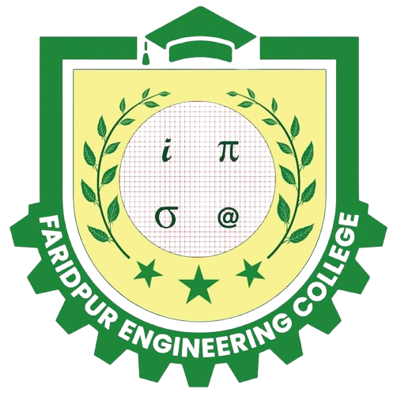

# FEC DLD Virtual Lab

[](https://github.com/sajid-sys/FEC-DLD-Virtual-Lab/actions/workflows/test.yml) [](LICENSE) [](CONTRIBUTING.md)

**Live lab: https://sajid-sys.github.io/FEC-DLD-Virtual-Lab/**



Digital Logic Design lab (CSE 1202 & CSE 1212), Faridpur Engineering College.

**Developed and maintained by Shahriar Hossen Sajid.**

A browser-based digital logic lab bench: a trainer board (+5 V supply, 16 input switches, 16 LEDs, a CLOCK pulse button, logic probe), a full breadboard and 69 real 74-series TTL and 4000-series CMOS ICs. Students wire circuits like they would in the lab, and the app checks them against the truth table — or, for flip-flops, registers and counters, against a step-by-step clock sequence.

## Using the lab

- **Wiring:** click (or tap) a hole, then another hole or a trainer socket. Every IC needs power.
- **On a phone:** press and hold a hole or pin to see its level on the logic probe. Turn the phone sideways for a bigger board, or pinch to zoom.
- **Board tools:** Guide (lights up the next connection), Signals (colours wires by level), Flow (moving dots trace HIGH signals from their source), Power.
- **CLOCK button** (or Space) sends one pulse to flip-flops, registers and counters.
- **Check my circuit** replays the truth table row by row on the board (Skip jumps to the result).
- **Shortcuts:** 0–9 flip S0–S9, Shift+0–5 flip S10–S15, Space = clock, Ctrl+Z / Ctrl+Y undo / redo.
- **Reduce animations** (Help tab) turns the effects off; the device's reduce-motion setting does the same.
- **Circuit codes** (ICs tab) save or share a circuit. Codes are checked strictly before loading.

## Experiments

| Group | Experiments | ICs |
|---|---|---|
| Exp 1 · Fundamental logic gates | AND, OR, NOT, NAND, NOR, XOR, XNOR | 7408, 7432, 7404, 7400, 7402, 7486 |
| More logic gates | 3-input NAND/AND/NOR, 4-input NAND/AND, 4-input NOR with strobe, 8-input NAND, open-collector XNOR, Schmitt-trigger inverter | 7410, 7411, 7427, 7420, 7421, 7425, 7430, 74266, 7414 |
| CMOS logic gates | 2-input OR/AND/XOR/XNOR, 3-input OR/AND, 4-input OR/AND | CD4071, CD4081, CD4070, CD4077, CD4075, CD4073, CD4072, CD4082 |
| Exp 2 · Universality of NAND | NOT, AND, OR from NAND | 7400 |
| Exp 3 · Universality of NOR | NOT, OR, AND from NOR | 7402 |
| Exp 4 · Simplification | F = Σm(1,3,5,6,7) → C + AB | 7408, 7432 |
| Exp 5 · Half adder | Half adder | 7486, 7408 |
| Exp 6 · Full adder | Full adder | 7486, 7408, 7432 |
| Arithmetic | 4-bit adder, 4-bit adder-subtractor, 4-bit ALU, look-ahead carry generator | 7483, 74283 + 7486, 74181, 74182 |
| Encoder | 4-to-2 (gates), 8-to-3 priority, 10-to-4 priority (decimal to BCD) | 7432, 74148, 74147 |
| Decoder | 2-to-4 (gates), 3-to-8, dual 2-to-4, BCD-to-decimal, 4-to-16 | 7404, 7408, 74138, 74139, 7442, 74154 |
| Multiplexer | 2-to-1 (gates), 8-to-1, quad 2-to-1, dual 4-to-1, function generator with 16-to-1 | 7404, 7408, 7432, 74151, 74157, 74153, 74150 |
| Demultiplexer | 1-to-2 (gates), 1-to-8 (two ways) | 7404, 7408, 74138, 74155 |
| Comparator | 1-bit (gates), 4-bit TTL, 4-bit CMOS | 7404, 7408, 7486, 7485, CD4585 |
| Flip-flops and latches | D, JK, T (from JK), 2-bit ripple counter, 4-bit latch, 4-bit and 6-bit registers | 7474, 7476, 74112, 74107, 7475, 74175, 74174 |
| Shift registers | parallel-access, serial-in parallel-out, parallel-in serial-out, with output latch; CMOS SIPO, shift-and-store, PISO | 7495, 74164, 74165, 74595, CD4015, CD4094, CD4014 |
| Counters | decade, divide-by-12, 4-bit binary, MOD-10 by reset, synchronous decade/binary (direct and synchronous clear), up/down single- and dual-clock, CMOS decade with decoded outputs, 12- and 14-stage binary | 7490, 7492, 7493, 74160–74163, 74190, 74191, 74192, 74193, CD4017, CD4020, CD4040, CD4060 |

## Project structure

```
assets/logo.png     Faridpur Engineering College logo
index.html          Page layout (header, sidebar, bench, tool buttons)
css/style.css       All styles, light and dark theme
js/core.js          No-DOM logic: board geometry, IC library and pinouts,
                    logic simulator, experiments, solutions, guided-build steps
js/app.js           User interface: drawing the board, wiring, dragging ICs,
                    zoom/pan, experiment sheets, diagrams, checker, guide
tests/run-tests.js  Automated test for every experiment and for circuit-code validation
LICENSE             GNU GPL v3.0
ADDITIONAL-TERMS.md Additional terms (author credit, name, logo)
CONTRIBUTING.md     How to contribute
```

No build step and no dependencies — it is plain HTML, CSS and JavaScript.

## Run it on your computer

Open `index.html` directly in a browser, or start a small local server:

```
npm start            # serves the folder at http://localhost:3000
```

## Run the tests

Requires Node.js.

```
npm test
```

It builds each experiment's reference solution and confirms that it passes every row of the truth table (or every step of the clock sequence), that an empty breadboard fails, that the guided-build steps match the solution and that the solution is a valid circuit code. It also checks that unsafe or broken circuit codes (HTML in a chip label, a script in a wire colour, an IC off the breadboard, overlapping ICs and so on) are rejected.

## Publish on GitHub Pages

1. Push this folder to a public GitHub repository (for example `dld-lab`).
2. In the repository go to **Settings → Pages**, set Source to **Deploy from a branch**, choose **main** and **/(root)**, and save.
3. After a minute or two the lab is live at `https://<your-username>.github.io/dld-lab/`.

## How to change things

- **Add or edit an experiment:** add an entry to the `EXPS` array in `js/core.js`. Give it `ins`/`outs` (switch and LED mapping), a truth function `f`, the `steps` text and a `solve(api)` function that builds the reference circuit. The guide and the checker are generated from `solve` automatically. For a gate-level circuit, add a schematic to `SCH` in `js/app.js`; otherwise a block diagram is drawn.
- **One-chip experiments** are easiest with `chipExp({...})`: list the inputs (`[name, pin]`), outputs, pins tied to +5 V or GND, CLOCK pins and pin-to-pin links, and the wiring, guide and procedure text are generated. For flip-flops, registers and counters give `seq` (each step: switch values and number of CLOCK pulses) and `model(state, inputs, pulses)` instead of `f`.
- **Add an IC:** use `gateChip(...)` or `msiChip(...)` in `js/core.js` with its pin names and logic function (for a clocked chip, `seq: {init, step, out}`) and a category `cat`. It appears in the ICs tab automatically.
- **Colours and fonts:** CSS variables at the top of `css/style.css`.

## How the simulation works

Every breadboard column strip, rail and trainer socket is a node. Wires merge nodes into nets (union-find). Each net is driven by the supply, the switches or IC outputs; a net driven both HIGH and LOW is reported as a short. ICs only work when their VCC pin is at +5 V and their GND pin at 0 V, and unconnected TTL inputs read as HIGH, like real 74LS chips. A floating CMOS input is undefined on a real chip; the lab reads it as LOW and warns about it. ICs are evaluated repeatedly until the outputs settle. Flip-flops, registers and counters keep their state between runs: after the logic settles they react to clock edges and to set/clear/load inputs, then the logic settles again, until nothing changes — so synchronous circuits clock together and ripple counters ripple stage by stage.

## Contributing

This is an open-source project and contributions are welcome — bug reports, new chips and experiments, better explanations, fixes. Start with [CONTRIBUTING.md](CONTRIBUTING.md); it explains the setup (no build step), how to add a chip or an experiment, what stays the same (the name, the author credit, the core look and features), and the pull-request checklist. Every pull request is reviewed by the maintainer. Please follow the [Code of Conduct](CODE_OF_CONDUCT.md), and report security problems privately as described in [SECURITY.md](SECURITY.md).

## License

Copyright (C) 2026 Shahriar Hossen Sajid.

Free software under the [GNU General Public License v3.0](LICENSE) with [additional terms](ADDITIONAL-TERMS.md) (GPL section 7). In short: you may use, study, change and share it, but every copy or modified version must stay open source under the same license, keep "Developed and maintained by Shahriar Hossen Sajid" visible in the app, use a different name if modified, and not use the project name or logos. The Faridpur Engineering College logo (`assets/logo.png`) belongs to the college and is not covered by the license.
